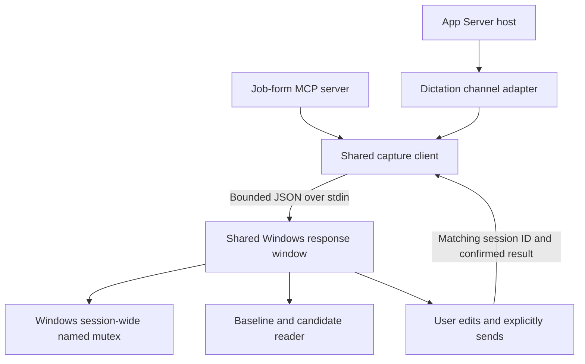

# Dictation bridge upgrade

This iteration keeps Codex desktop Dictation as the voice provider. It implements a shared capture client and response window for the standalone App Server host and the job-form MCP plugin.

## Interaction

The window identifies the asking task, displays the question and available choices, and reads the question using asynchronous Windows speech. Opening the window does not start the microphone. The user chooses Start Dictation explicitly, or types/selects an answer. After stopping with the configured shortcut, the user ticks the stopped checkbox before sending or closing. A countdown bounds the entire question. Keyboard users can tab between controls, use Enter to send, and Escape to cancel.

After stopping Dictation with its configured shortcut, the user must review the answer and choose **Send answer**. This deliberate extra step replaces the old automatic return of the first eligible transcript. History timestamps and global surface markers cannot prove recording ownership. Review is therefore required for every answer; the implementation makes no claim of automatic ownership proof.

The plugin defaults to `%n` (Alt+N) and accepts `CODEX_DICTATION_HOTKEY` as a SendKeys override. The host accepts `--dictation-hotkey`. The bridge does not change the app's shortcut settings. Manual Cancel/window close is blocked until the user confirms Dictation is stopped. Deadline/disconnect cleanup can still force-close the helper and reports recording as potentially active; it cannot guarantee microphone shutdown. Cancellation does not blindly toggle that shortcut because a toggle could start a recording that was already stopped. If capture may still be active, the caller receives a warning to check and stop it.

## Components and boundaries

- `plugin/job-form-voice-bridge/mcp/capture.mjs` owns FIFO scheduling, total deadlines, child-process lifecycle, bounded output, capture-session IDs, and graceful cancellation. Prompts travel over stdin rather than process arguments. A temporary directory holds only a cancellation marker and is removed after the helper closes.
- `plugin/job-form-voice-bridge/scripts/response-window.ps1` owns the UI and Dictation controls. Both old capture-script paths forward to this implementation.
- `dictation-history.ps1` excludes existing directories even if their metadata is incomplete or unreadable, uses capture start without a backwards clock-skew allowance, excludes composer records from legacy recovery when their rich record identifies the surface, and returns every eligible candidate. Multiple candidates require typed resolution rather than choosing the earliest.
- A Windows session-wide named mutex prevents cooperating bridge processes in the same logon session from controlling Dictation concurrently. It does not prevent unrelated applications or manual Dictation. Typed answers remain available while another bridge owns the mutex.
- The coordinator cancels channel work when its request is cleared, its turn completes, or the connection ends. It stops waiting even if a third-party channel ignores cancellation. The maintained Dictation adapter passes cancellation into the helper. No old answer is replayed after reconnect.
- The plugin handles MCP cancellation and input closure, rejects malformed and duplicate active calls, validates finite-choice answers, and returns explicit outcomes. A cancelled question does not automatically retry itself.
- Exact and ordinal choice matching is shared. Unicode labels are preserved; fuzzy or open-ended semantic matching is not used for decisions. Length constraints are checked. Unsupported pattern/format constraints are not claimed as validated.

The task owns field validation and continuation. A confirmed transcript means the user sent an answer; `answer-sent` means the host wrote a response; `cleared` means Codex cleared the request. Neither proves the browser field was filled or the task succeeded. The calling agent must recheck the current target and report what it actually did next.

## Quality checks

The repo has development-only dependencies, a locked package manager, TypeScript checks with unused-code checks, formatting, regression tests, PowerShell parsing checks, and a Windows/Linux CI definition. Generated protocol snapshots are excluded from formatting and are not edited by hand.

The automated tests exercise transcript confirmation, session mismatch, cancellation before and during capture, helper failure/output limits, Unicode transport, no-TTY fallback, request clearance, cross-thread isolation, choice matching, incomplete history, and a real Windows mutex across separate processes. They use synthetic history and child helpers, not private transcripts or the microphone. Existing historical audit fixtures remain historical evidence.

## Live acceptance still required

Run `pnpm doctor` before a controlled Dictation smoke test. Check the actual selected CLI and desktop build separately: a PATH version is not the desktop version. The doctor does not enable the microphone, inspect transcript contents, claim live schema compatibility, or silently change configuration. Its warnings require attention even if there are no hard failures.

For the live check, use a synthetic field with known options. Stop Dictation, review/send the answer, verify the original request receives it, and observe a separate subsequent task step. Also check Cancel, retry, typing, focus changes, no speech, and a stopped/absent desktop app. UI rendering and synthetic tests do not substitute for that live interaction.

The optional legacy local-Whisper adapter remains available but is not the focus of these changes. This iteration adds no new speech provider, hosted service, telemetry, or background installation.
